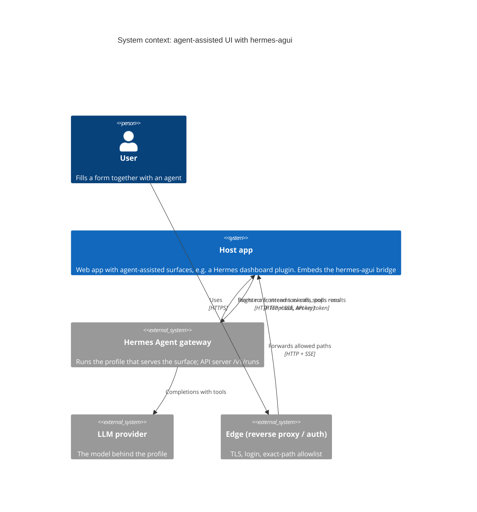
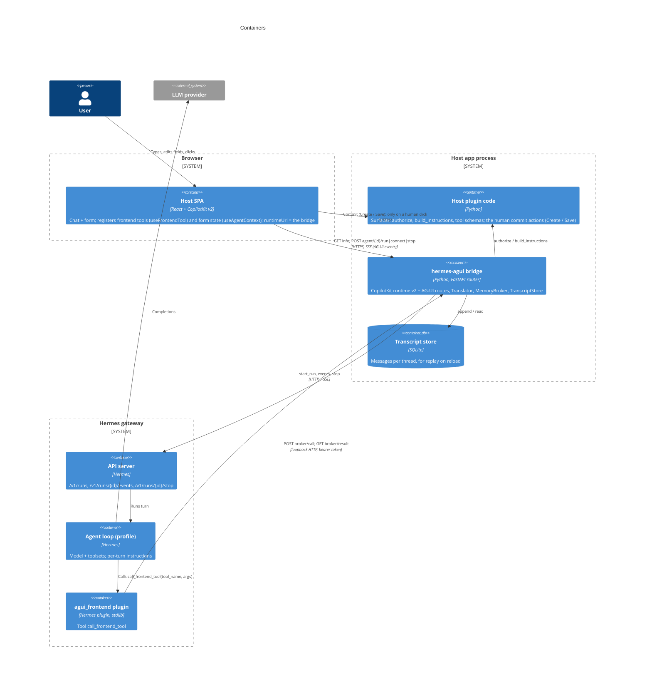
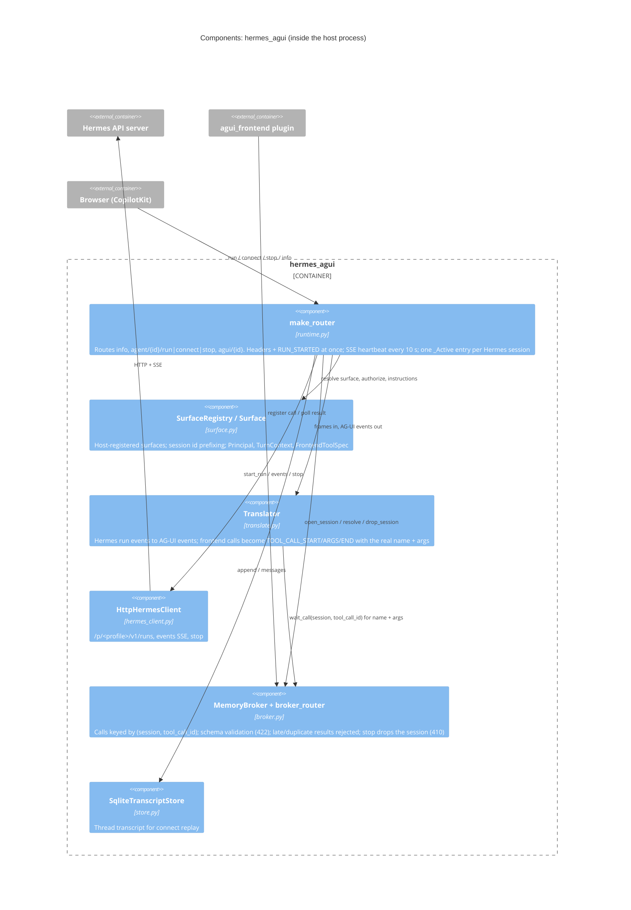
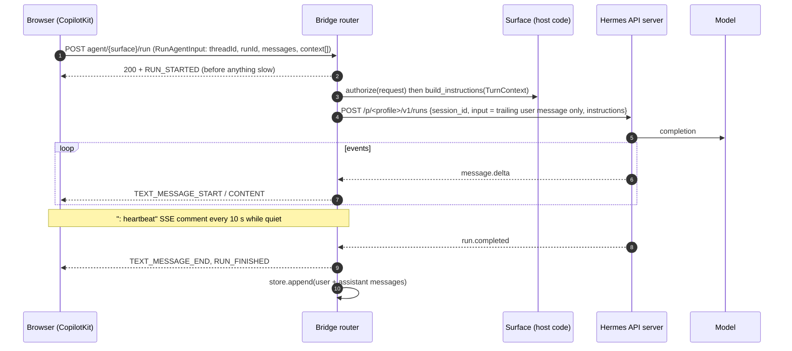
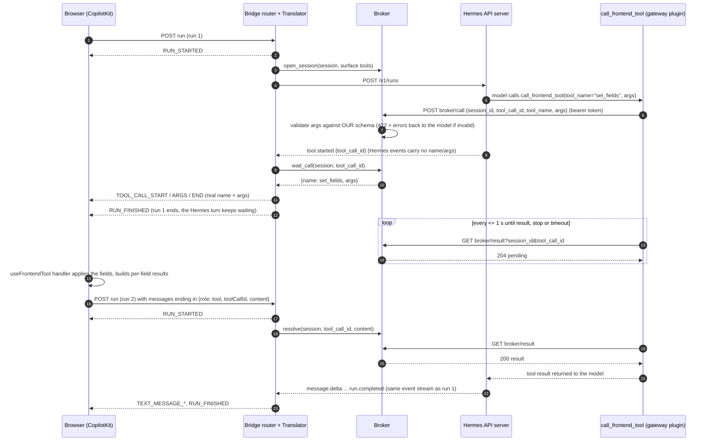
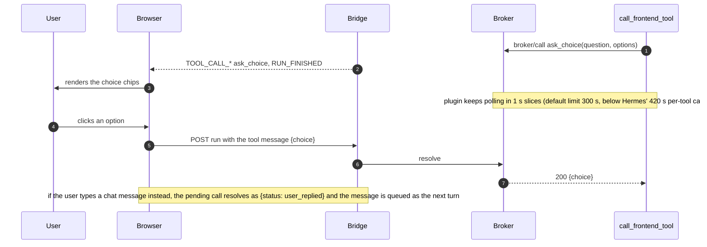
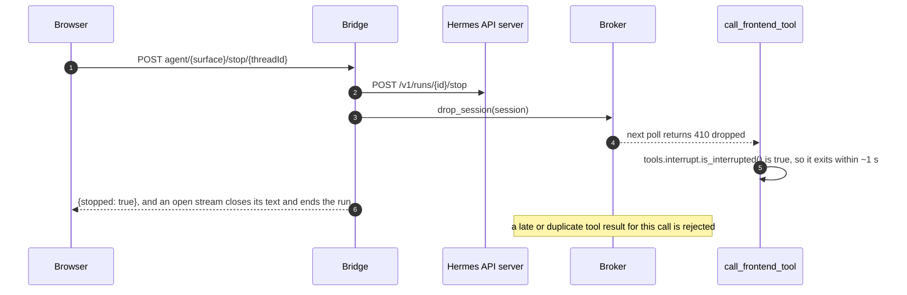
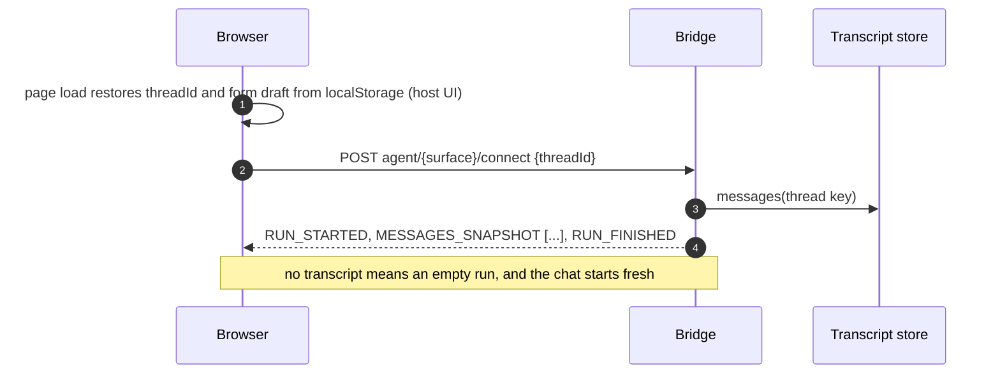
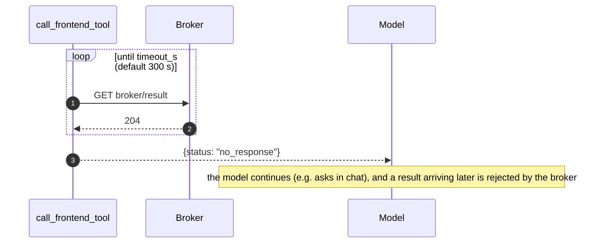
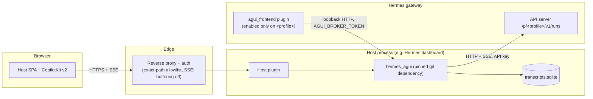

# Architecture

hermes-agui connects a browser UI built with [CopilotKit](https://github.com/CopilotKit/CopilotKit) (or any
[AG-UI](https://github.com/ag-ui-protocol/ag-ui) client) to a [Hermes Agent](https://github.com/NousResearch/hermes-agent)
profile. It also lets the agent call **frontend tools**: actions that run in the user's browser, such as filling a form
field, with the result going back to the agent.

It has two halves:

| Half | Runs in | Code | Job |
|---|---|---|---|
| **Bridge** (library) | The host app's process, e.g. a Hermes dashboard plugin | `hermes_agui/` | CopilotKit runtime-v2 + AG-UI endpoints, Hermes API client, event translation, transcript, broker |
| **Gateway plugin** | The Hermes gateway, on profiles that serve agentic surfaces | `plugin/` | The `call_frontend_tool` tool the model calls |

Placeholders used below: `<host>` is the host app's mount prefix, `<profile>` is the Hermes profile that serves the
surface.

## Concepts

- **Surface:** one agent-assisted UI, such as a form, registered by the host app. Its `id` is the CopilotKit
  `agentId`. A surface defines the Hermes profile that serves it, who may use it (`authorize`), the per-turn
  instructions (`build_instructions`), and the frontend tools it allows (`FrontendToolSpec`, whose JSON Schemas live on
  the server and are authoritative).
- **Thread → Hermes session:** each CopilotKit thread maps to one Hermes session, `<surface>:<principal>:<threadId>`.
- **Turn vs run:** one Hermes turn can span several AG-UI runs. Run 1 ends when the agent calls a frontend tool. The
  browser executes the tool and starts run 2 carrying the result, and the bridge keeps streaming the same Hermes turn
  into it.
- **Broker:** an in-memory meeting point. The gateway registers each frontend call there with its name and args, and
  the bridge resolves it with the browser's result. It is reachable only on loopback, with a bearer token.

## C4: system context

## C4: containers

## C4: components of the bridge

## Flows

### 1. A plain chat turn

The client re-sends the full history on every run. The bridge sends Hermes only the new trailing message, because
Hermes keeps the session itself. The per-turn `instructions` carry live state (form values, ownership, allowed tools)
and are never stored by Hermes.

### 2. A frontend tool call (one Hermes turn, two AG-UI runs)

### 3. Human-in-the-loop tool (the agent asks, the user clicks)

### 4. Stop

### 5. Reload: the chat comes back

### 6. The browser never answers

## Security model

- **Authorization is the host's job.** Every route calls `Surface.authorize(request)` with the host's own session and
  CSRF checks. Client `context[]` is data for the prompt and never grants access.
- **Frontend tool args are validated server-side** against the surface's `FrontendToolSpec` schemas. CopilotKit's
  zod-to-JSON-schema conversion is lossy, so the server schemas win. An invalid call returns the errors to the model
  instead of reaching the browser.
- **The broker is loopback-only** and protected by a bearer token: `AGUI_BROKER_TOKEN` in the profile `.env`, compared
  in constant time. Hosts must never route `broker/*` through the public edge.
- **The agent never commits.** Creating or saving is a human click in the host UI. Frontend tools only change local
  form state.
- **Session ids are prefixed per surface**, so threads can't collide across surfaces or profiles on a multiplexed
  gateway.

## Edge requirements

- Send headers and `RUN_STARTED` immediately. Some auth proxies return 502 when headers take more than about 30 s.
- Keep the SSE heartbeat (every 10 s) under the shortest idle timeout on the path: nginx defaults to 60 s, and CDNs
  commonly allow about 100–125 s.
- Serve the run/connect paths with proxy buffering off and a long read timeout. Allow-list exact paths. Stop needs a
  pattern match because of `{threadId}`.

## Deployment

Install steps and the tested packaging options are in [`docs/packaging.md`](docs/packaging.md). The design history and
spike evidence are in [`docs/design/`](docs/design/).
