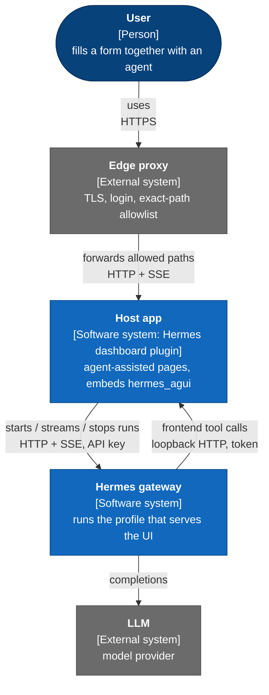
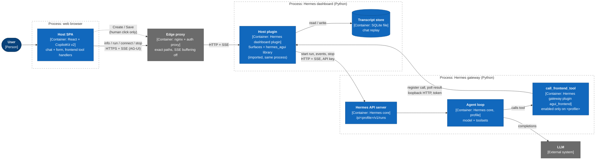
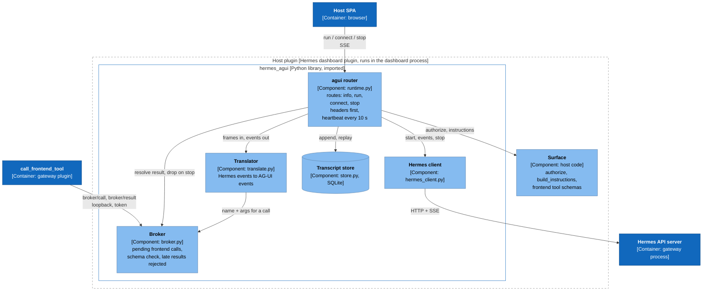
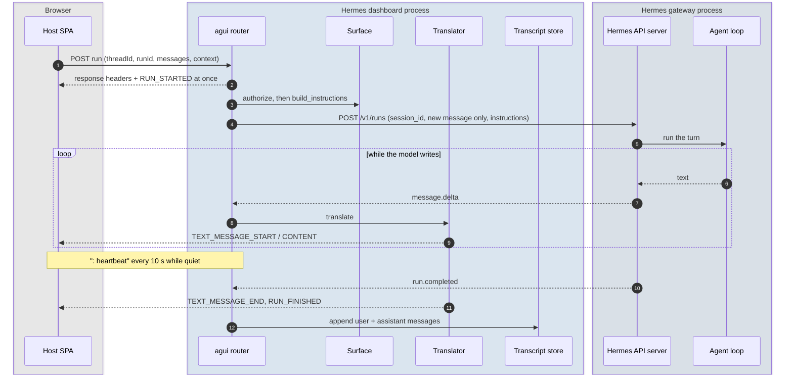
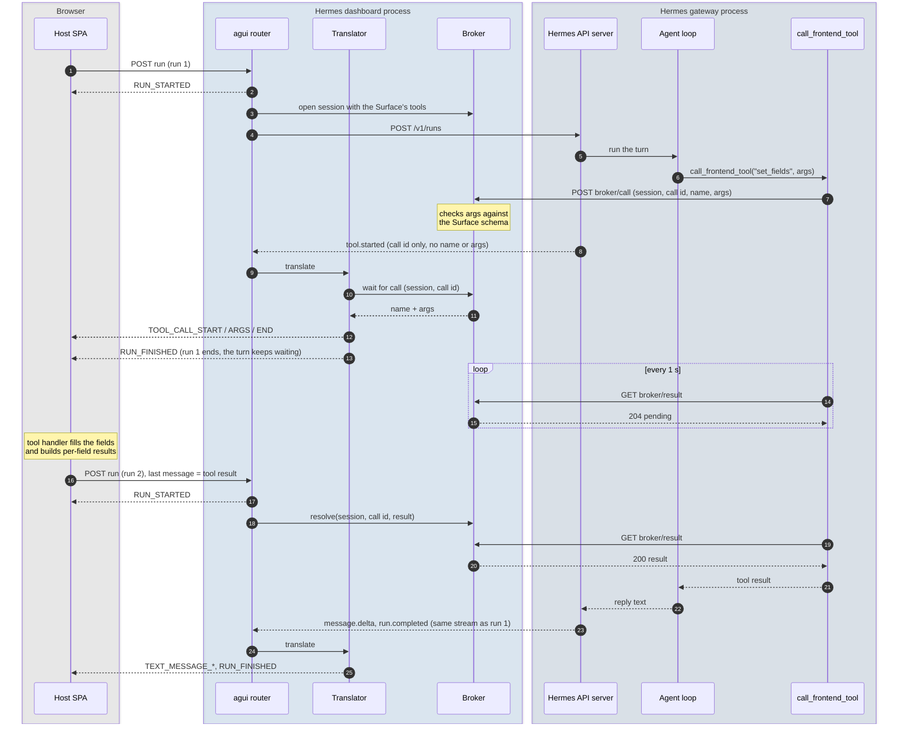
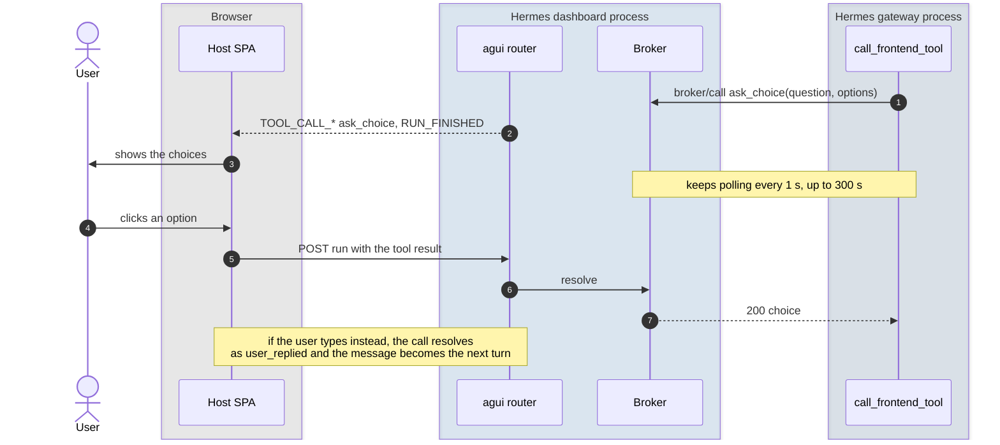
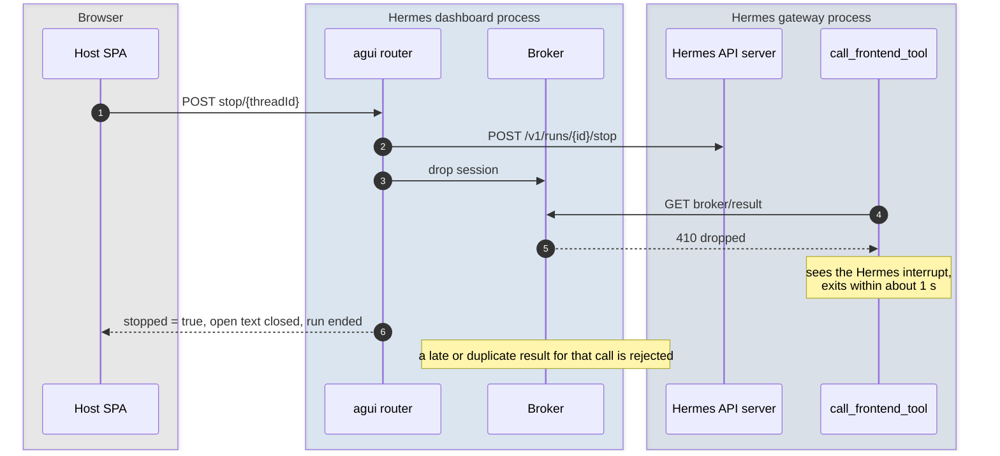
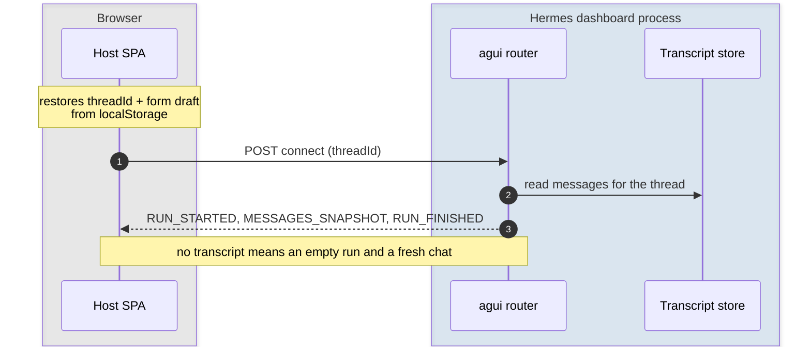
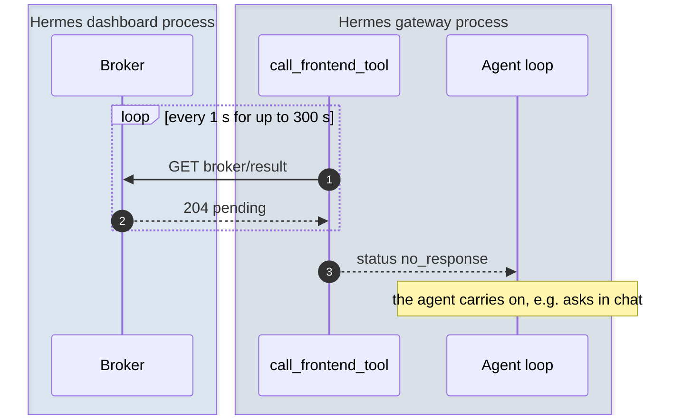

# Architecture

hermes-agui connects a browser UI built with [CopilotKit](https://github.com/CopilotKit/CopilotKit) (or any
[AG-UI](https://github.com/ag-ui-protocol/ag-ui) client) to a [Hermes Agent](https://github.com/NousResearch/hermes-agent)
profile. It also lets the agent call **frontend tools**: actions that run in the user's browser, such as filling a form
field, with the result going back to the agent.

**Nothing here is a separate service.** hermes-agui ships two pieces, and both run inside processes that already
exist:

| Piece | What it is | Runs inside | Code |
|---|---|---|---|
| **hermes_agui** | Python **library**, imported by a host app's Hermes **dashboard plugin** | The Hermes dashboard process | `hermes_agui/` |
| **agui_frontend** | Hermes **gateway plugin** that registers the tool `call_frontend_tool` | The Hermes gateway process, enabled only on the profile that serves the UI | `plugin/` |

The diagrams use the same names everywhere. The C4 diagrams below are drawn as Mermaid flowcharts with C4 notation,
because Mermaid's native C4 renderer overlaps text on GitHub.

**Legend:**
- Dark blue = person.
- Blue = container (something that runs or stores data).
- Light blue = component inside a container.
- Grey = external system.
- Dashed boxes = OS processes.
- Each box says **what kind of thing it is** in brackets.

## Names used in every diagram

| Name | Kind | Lives in |
|---|---|---|
| **Host SPA** | Web app (React + CopilotKit v2) | Browser |
| **Edge proxy** | Reverse proxy + login (e.g. nginx + an auth proxy) | Its own container(s) |
| **Host plugin** | Hermes dashboard plugin of the host app (e.g. hermes-items) | Hermes dashboard process |
| **Surface** | Host code: one agent-assisted UI (authorize, instructions, tool schemas) | Host plugin |
| **agui router** | `make_router` (CopilotKit runtime v2 + AG-UI routes) | hermes_agui, in the Host plugin |
| **Translator** | Hermes events → AG-UI events | hermes_agui |
| **Broker** | `MemoryBroker` + its HTTP routes `broker_router` | hermes_agui |
| **Hermes client** | `HttpHermesClient` | hermes_agui |
| **Transcript store** | `SqliteTranscriptStore` (a SQLite file) | hermes_agui |
| **Hermes API server** | `/p/<profile>/v1/runs` | Hermes gateway process |
| **Agent loop** | The profile's model + tools loop | Hermes gateway process |
| **call_frontend_tool** | The tool of the agui_frontend gateway plugin | Hermes gateway process |
| **LLM** | Model provider | External |

## C4 level 1: system context

## C4 level 2: containers and where they run

## C4 level 3: components inside the Host plugin

## Flows

Each participant is a box from the diagrams above, grouped by the process it runs in.

### 1. A plain chat turn

The browser re-sends the whole history on every run. The agui router sends the Hermes API server only the new last
message, because Hermes keeps the session itself. The per-turn instructions carry live state (form values,
ownership, allowed tools) and Hermes never stores them.

### 2. A frontend tool call: one Hermes turn, two browser runs

If the args are invalid, `broker/call` answers 422. call_frontend_tool then returns the errors to the Agent loop, and
nothing reaches the browser.

### 3. The agent asks, the user clicks

### 4. Stop

### 5. Reload: the chat comes back

### 6. The browser never answers

300 s is the default `timeout_s`, which stays under Hermes' 420 s per-tool limit.

## Security model

- **The Surface decides access.** Every route calls `authorize` with the host's own session and CSRF checks. The
  browser's `context` is prompt data only and never grants access.
- **Frontend tool args are checked on the server** against the Surface's schemas. CopilotKit's zod-to-JSON-schema
  conversion is lossy, so the server schemas win.
- **The Broker's HTTP routes are loopback-only** and need a bearer token: `AGUI_BROKER_TOKEN` in the profile `.env`,
  compared in constant time. The Edge proxy must never expose `broker/*`.
- **The agent never commits.** Create and Save are human clicks in the Host SPA. Frontend tools only change the form
  in the browser.
- **Session ids carry the Surface id**, so threads can't collide across surfaces or profiles.

## Edge proxy requirements

- Response headers and `RUN_STARTED` go out at once. Some auth proxies return 502 when headers take more than about 30 s.
- The 10 s heartbeat must stay under the shortest idle timeout on the path: nginx defaults to 60 s, and CDNs commonly
  allow about 100–125 s.
- Run and connect paths need proxy buffering off and a long read timeout. Allow-list exact paths; stop needs a pattern
  match because of `{threadId}`.

## Install

Both pieces are pinned to the same commit. The host plugin declares `hermes-agui` as a pinned git dependency, and the
gateway plugin is installed on the serving profile. Details and the packaging options tested are in
[`docs/packaging.md`](docs/packaging.md); the design history is in [`docs/design/`](docs/design/).
